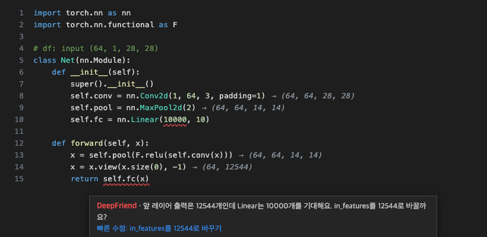

# DeepFriend — a deep-learning study buddy for VS Code

**Shows tensor-shape errors in PyTorch/TensorFlow code before you run it, and explains in plain words why training is not working.**
One click to install: no pip install, no API key, no config files. The interface is Korean by default; switch with `"deepfriend.language": "en"`.

[한국어 README](README.md) · [FAQ](docs/faq.md) · [Privacy](docs/privacy.en.md) · [Terms](docs/terms.en.md) · [Issues](https://github.com/mrpark10/DeepFriend/issues)



## Features

| Feature | What it does |
|---|---|
| **Live shape hints** | Each layer line ends with its output shape, e.g. `→ (32, 64, 112, 112)`. Mismatches get a red squiggle, a plain-language explanation and a **quick fix**, before you run anything. |
| **Training doctor** | Add `deepfriend.watch()` and the bottom panel shows live loss/accuracy charts and diagnoses NaN, overfitting, plateaus, oscillation and chance-level accuracy, with "what / why / try this" cards and code-fix buttons. |
| **Error explanations** | Python errors in the terminal or Jupyter open a card: what it means, why it happens, how to fix it. Jump to the line, install missing packages with one click. |
| **Model structure** | See your model as blocks in the DeepFriend sidebar, with parameter counts and a rough memory estimate. Click a block to jump to the code. |
| **Experiment log** | Every watched run's settings, results and code are saved in `.deepfriend/` in your project. Compare two runs and restore the best code. |
| **Concept hovers** | Hover `nn.Conv2d` or `kernel_size=` for a simple explanation and diagram (beginner/normal). |

## Quick start

1. Install **DeepFriend**.
2. Write the input shape above your model class (or click **Set input shape** above it):
   ```python
   # df: input (32, 3, 224, 224)
   class Net(nn.Module):
   ```
3. Add `import deepfriend; deepfriend.watch()` to your training script and run it in the VS Code terminal.

Try **DeepFriend: Open Example** from the command palette for offline examples.

## Requirements

VS Code 1.93+ (Cursor/Windsurf via Open VSX), Python 3.9+, PyTorch 2.x or TensorFlow 2.x. Without Python, error explanations and concept hovers still work; shape hints work without PyTorch by reading the code.

## Privacy

Code and run records stay on your computer; DeepFriend collects nothing. Optional AI rewording always shows what will be sent and asks first. See the [privacy policy](docs/privacy.en.md).

## License

MIT © 2026 Junho Park
