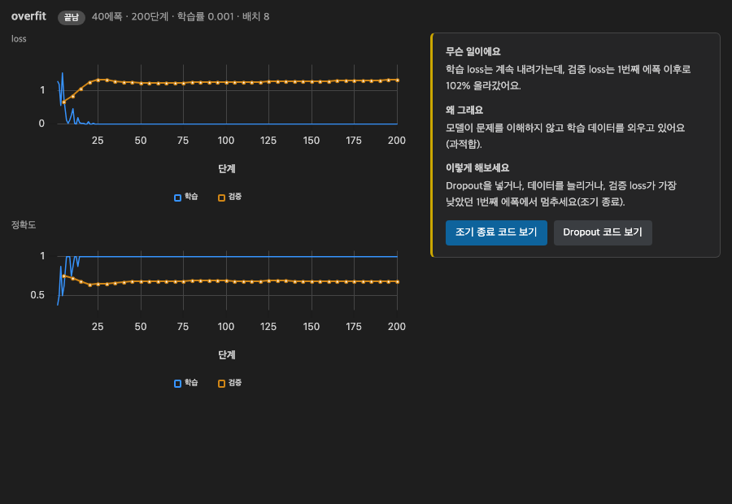
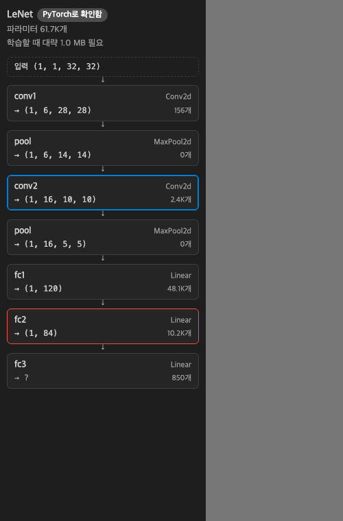
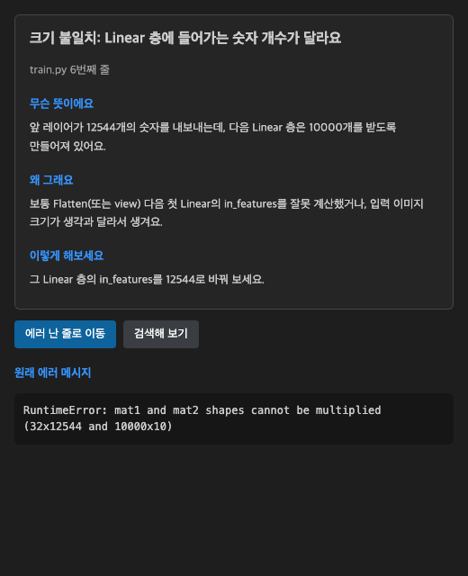

# DeepFriend — 딥러닝 학습 도우미 (VS Code)

**PyTorch·TensorFlow 코드를 돌려보기 전에 데이터 크기 에러를 보여주고, 학습이 왜 안 되는지 쉬운 한국어로 알려주는 VS Code 확장이에요.**
설치 버튼 하나면 끝이에요. pip 설치도, API 키도, 설정 파일 편집도 필요 없어요.

[English README](README.en.md) · [자주 묻는 질문](docs/faq.md) · [개인정보처리방침](docs/privacy.md) · [이용약관](docs/terms.md) · [문의·오류 신고](https://github.com/mrpark10/DeepFriend/issues)


## 무엇을 해 주나요?

| 기능 | 하는 일 |
|---|---|
| **실시간 크기 표시** | 레이어 줄 끝에 `→ (32, 64, 112, 112)`처럼 데이터 크기를 보여줘요. 크기가 안 맞으면 실행하기 전에 빨간 밑줄과 한국어 설명, **빠른 수정** 버튼이 나와요. |
| **학습 닥터** | `deepfriend.watch()` 한 줄이면 아래 패널에 loss·정확도 그래프가 실시간으로 그려지고, NaN·과적합·정체·출렁임·찍기 수준을 진단해 "무슨 일이에요 / 왜 그래요 / 이렇게 해보세요" 카드로 알려줘요. 학습률을 바꾸는 코드 수정 버튼도 있어요. |
| **한국어 에러 해설** | 터미널이나 Jupyter에서 파이썬 에러가 나면 "무슨 뜻 / 원인 / 고치는 법" 카드가 떠요. 에러 난 줄로 바로 이동하고, 없는 패키지는 버튼으로 설치해요. |
| **모델 구조 그림** | 왼쪽 DeepFriend 아이콘에서 모델을 블록 그림으로 보고, 블록을 누르면 코드로 이동해요. 파라미터 수와 대략적인 메모리도 보여줘요. |
| **실험 자동 기록** | `watch()`로 돌린 학습마다 설정·결과·코드를 프로젝트의 `.deepfriend/` 폴더에 저장해요. 두 실험의 설정 차이와 그래프를 비교하고, 가장 좋았던 코드로 되돌릴 수 있어요. |
| **개념 설명 호버** | `nn.Conv2d`, `kernel_size=` 같은 이름에 마우스를 올리면 쉬운 설명과 그림이 나와요 (입문/보통 난이도). |



## 3단계로 시작하기

1. 마켓플레이스에서 **DeepFriend**를 설치해요.
2. 모델 클래스 위에 입력 크기를 한 줄 적어요. (모르면 클래스 위의 **입력 크기 정하기** 버튼을 눌러요.)
   ```python
   # df: input (32, 3, 224, 224)
   class Net(nn.Module):
   ```
3. 학습 코드에 이 한 줄을 넣고 VS Code 터미널에서 실행해요.
   ```python
   import deepfriend; deepfriend.watch()
   ```

처음이라면 명령 팔레트(`Ctrl+Shift+P` / `Cmd+Shift+P`)에서 **DeepFriend: 예제 열기**를 실행해 보세요. 인터넷 없이 1분 안에 돌아가는 예제가 들어 있어요.

## 필요한 것

- VS Code 1.93 이상 (Cursor·Windsurf 등 VS Code 계열 에디터도 Open VSX에서 설치 가능)
- Python 3.9 이상 — PyTorch 2.x 또는 TensorFlow 2.x (Keras)
- 파이썬이 없어도 에러 해설과 개념 설명은 동작해요. 크기 표시는 PyTorch 없이도 코드만 읽어서 계산해요.

## 크기 표시가 지원하는 것

- **PyTorch**: Linear, Conv1d/2d, MaxPool·AvgPool·AdaptivePool, Flatten, BatchNorm, LayerNorm, Dropout, 모든 활성화 함수, Embedding, LSTM·GRU·RNN, MultiheadAttention, `nn.Sequential`·`nn.ModuleList`, 같은 파일의 직접 만든 모듈, `view`·`reshape`·`flatten`·`torch.cat`·`permute`·인덱싱 등
- **Keras**: Dense, Conv2D, MaxPooling2D, AveragePooling2D, GlobalPooling, Flatten, Dropout, BatchNormalization, Embedding, Reshape (Sequential과 함수형 API)
- PyTorch가 설치돼 있으면 실제 계산 없이 크기만 계산하는 가짜 텐서(meta)로 한 번 더 확인해요. 학습 코드 전체를 실행하지는 않아요.
- 계산할 수 없는 줄은 틀린 숫자 대신 `?`로 보여주고, 마우스를 올리면 이유를 알려줘요.

 

## 개인정보

- 코드와 실험 기록은 **내 컴퓨터에만** 저장돼요. DeepFriend는 아무 정보도 수집하지 않아요.
- AI 문장 다듬기는 선택 기능이에요. 켜더라도 보낼 내용을 먼저 보여주고 허락을 받아요. 자세한 내용은 [개인정보처리방침](docs/privacy.md)을 보세요.

## 설정

| 설정 | 설명 |
|---|---|
| `deepfriend.language` | 화면 언어: 한국어(기본) / English |
| `deepfriend.level` | 설명 난이도: 입문(기본) / 보통 |
| `deepfriend.autoRecord` | 실험 자동 기록 켜기/끄기 |
| `deepfriend.ai.provider` | AI 사용: 끄기 / VS Code 내장 AI(Copilot 등, 키 불필요) / Anthropic / OpenAI 호환 |
| `deepfriend.ai.consent` | AI에 보내기 전 매번 묻기 / 항상 허용 / 보내지 않기 |
| `deepfriend.pythonPath` | 파이썬 경로 (비우면 자동으로 찾아요) |

## 문의

오류 신고와 제안은 [GitHub Issues](https://github.com/mrpark10/DeepFriend/issues)나 sk92977852@gmail.com 으로 보내 주세요.
확장 안에서도 명령 팔레트의 **DeepFriend: 오류 신고하기**로 버전 정보가 채워진 신고서를 열 수 있어요.

## 라이선스

MIT © 2026 박준호 (Junho Park)
